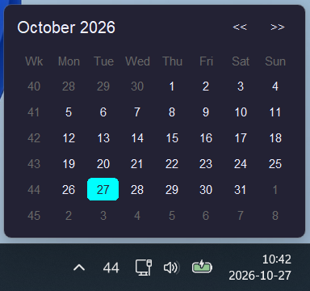
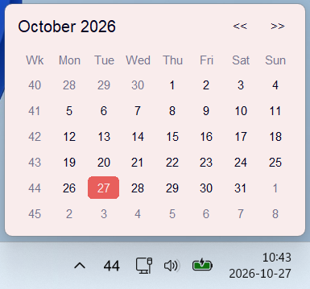

# WeekTrayMA - A System Tray Calendar for Windows

WeekTrayMA is a lightweight, standalone calendar application for Windows that lives in your system tray. It's designed to give you a quick view of the current month's calendar, with a special focus on showing the week number.

 


## Features

* **System Tray Integration:** See the current ISO week number conveniently displayed in your system tray.
* **Integrated Calendar:** Click the icon to open a calendar that shows week numbers for every month. Click it again, or anywhere else, to close it.
* **Light, Dark or Automatic Theme:** The calendar follows the Windows app theme, or a theme you pick. The tray number always matches the taskbar color so it stays readable.
* **Start with Windows:** Optionally launch WeekTrayMA when you sign in.

## Requirements

*   Windows 10 or 11
*   Python 3.10 or newer

## Usage

1.  **Create a virtual environment (recommended):**
    ```sh
    python -m venv .venv
    .venv\Scripts\activate
    ```

2.  **Install the dependencies:**
    ```sh
    pip install -r requirements.txt
    ```

3.  **Run the application:**
    ```sh
    python src/main.py
    ```

The application icon showing the current week number will appear in your system tray. Click the icon to open the calendar window.

## Settings

Right-click the tray icon:

* **Theme** › Automatic / Light / Dark
* **Start with Windows**
* **Quit**

The theme choice is saved in `%APPDATA%\WeekTrayMA\settings.json`. "Start with Windows" is stored in the registry under `HKCU\Software\Microsoft\Windows\CurrentVersion\Run`.

## Build

To build a single standalone executable:

```sh
pip install -r requirements-dev.txt
compile.bat
```

The executable is created at `dist\WeekTrayMA.exe`.

## Development

Run the tests with:

```sh
python -m pytest
```
